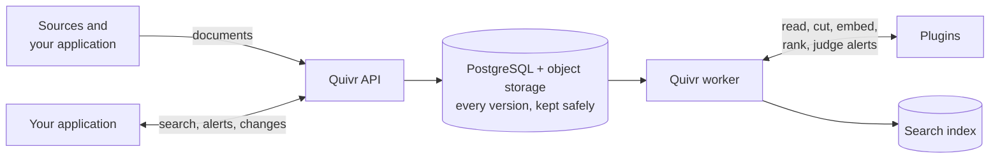

# Quivr

[](LICENSE)
[](https://deepwiki.com/The-Vibe-Company/quivr)

**An open-source engine for content that keeps arriving: store it, search it, and get
alerted when something new matches a topic you follow.**

You send Quivr documents (news articles, emails, posts, PDFs), or let it collect them
from RSS feeds, Microsoft 365 mailboxes and X lists. Quivr keeps every version, makes
each document searchable within seconds, and checks it against your saved alerts. Your
application talks to Quivr over an HTTP API; Quivr has no user interface of its own.

Quivr is developed by [The Vibe Company](https://www.thevibecompany.co), the AI agency
created by the Quivr team.

> **Status: Quivr 2.** From 2.0.0 on, the HTTP API (`/v0`) stays compatible across
> 2.x releases and upgrades keep your data in place; see
> [Versions and compatibility](https://docs.quivr.thevibecompany.co/reference/compatibility)
> and [Known limits](https://docs.quivr.thevibecompany.co/reference/known-limits).

## What you can do with it

- **Collect content** you send one by one or in batches, or that Quivr pulls from
  sources on a schedule. Files such as PDFs are read by plugins.
- **Search** by keywords, by meaning, or both. Every result points to the exact passage,
  document and version it comes from, so you can always cite it.
- **Follow a topic.** Save an alert such as `"harbour strike" AND (ferry OR port)`, or a
  plain-language description, and Quivr records every new document that matches, with
  the reason. Your application reads the matches or receives them as signed webhooks.
- **Keep history.** A correction becomes a new version; the old one stays readable. A
  withdrawn document leaves search at once, and alerts that caught it are told.
- **Plug in your own logic.** File formats, sources, embedding models, ranking and alert
  rules are plugins: small HTTP services you can replace, in any language.
- **Let AI agents use it.** `quivr mcp` lets an agent search Quivr and quote what it
  finds, with the source of every passage.

## How it works



Quivr confirms a document only once it is stored, then processes it in the background:
an outage delays processing but never loses what was confirmed. The search index can
always be rebuilt from storage. [How Quivr works](https://docs.quivr.thevibecompany.co/how-quivr-works)
explains the parts and the guarantees.

## Try it

You need Linux on x86_64 or a Mac with Apple Silicon, Docker with Compose v2, the Go
version in [`go.mod`](go.mod), Python 3.12 with `venv`, and `jq`. The first start
downloads about 1 GB.

```bash
git clone https://github.com/The-Vibe-Company/quivr.git && cd quivr
make dev                 # start Quivr and its dependencies in Docker
eval "$(make -s env)"    # point this shell at the API, with a local key
```

Then follow the [Quickstart](https://docs.quivr.thevibecompany.co/quickstart): create a
collection, add an article, find it by keyword and by meaning, and get alerted on a
topic, in about fifteen minutes. `make demo` adds a web app on top, at
http://127.0.0.1:5183 ([`quivr-search/`](quivr-search/README.md)).

To install Quivr on a server from published images, without a checkout, see
[Run Quivr on one machine](https://docs.quivr.thevibecompany.co/run-quivr/single-machine).

## Documentation

Everything is on [docs.quivr.thevibecompany.co](https://docs.quivr.thevibecompany.co):

| If you want to… | Start with |
| --- | --- |
| Understand Quivr | [Introduction](https://docs.quivr.thevibecompany.co/), then [Core concepts](https://docs.quivr.thevibecompany.co/concepts) |
| Build an application on it | [Quickstart](https://docs.quivr.thevibecompany.co/quickstart), then the guides under *Use Quivr* |
| Install and operate it | [Operate a Quivr deployment](https://docs.quivr.thevibecompany.co/run-quivr/overview) |
| Write a plugin | [How plugins work](https://docs.quivr.thevibecompany.co/plugins/overview), then [Build your first plugin](https://docs.quivr.thevibecompany.co/plugins/first-plugin) |
| Look up an endpoint, command or setting | [Reference](https://docs.quivr.thevibecompany.co/api-reference/overview) |

The site's source is [`docs-site/`](docs-site/). Documentation for people changing this
repository is listed on [the contributor start page](docs/start/contributor.md).

## Repository layout

```text
cmd/quivr/       the single quivr binary: api, worker, migrate, plugin tools, search, mcp
internal/        the engine, one Go package per domain module
contracts/       the HTTP API (OpenAPI) and plugin protocol contracts
sdks/            Go and Python kits for writing plugins
plugins/         first-party plugins: alerts, sources, PDF, ingestion, retrieval…
client/          Go client generated from the HTTP contract
migrations/      PostgreSQL migrations
deploy/          Compose, Railway and image build files
quivr-search/    demo web app built on the public API
docs-site/       the documentation site
docs/            contributor docs, decisions (docs/adr/) and dated records (docs/dated/)
scripts/         local stack, checks and measurement tooling
```

## Contributing

Read [`AGENTS.md`](AGENTS.md) for the rules and [`CONTEXT.md`](CONTEXT.md) for the
domain vocabulary, then [the contributor start page](docs/start/contributor.md). Run
`make check` (about two minutes, no Docker) before pushing; `make verify` runs the
end-to-end journeys on an isolated stack. Pull request titles follow Commitizen, for
example `feat(ingestion): accept record versions`.

Report security issues privately: see [`SECURITY.md`](SECURITY.md).

## License

MIT — see [LICENSE](LICENSE).
