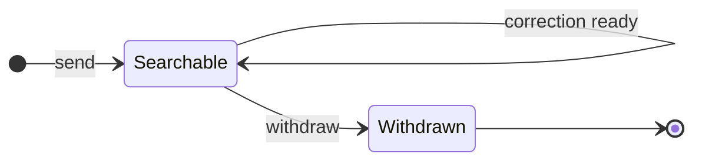

A handful of ideas covers almost everything you do with Quivr. This page explains each one with the same example, a news article, and gives the name the API uses for it in brackets. The [glossary](/glossary) lists every API name.

The article: _Harbour strike halts the ferry_, with the line "The harbour strike stopped every ferry to the island on Friday."

## Collections and documents

You put documents into a **collection** (a Corpus), and you search collections. A collection is also an access boundary: an API key can be limited to some collections. Our article goes into a collection called `News`.

Each article, email or post is a **document** (a Record). Quivr knows a document by three things together:

- the collection it is in;
- where it comes from (the Source Namespace), a short name such as `news` or `mail`;
- its identity there (the Record Key), such as the article's URL.

Send another text under the same three, and Quivr treats it as a new edition of the same document, not as a new document.

Everything belongs to an **organization**: its collections, documents and alerts. Your application calls Quivr with an **API key** that the operator gives it. The key decides the organization, which collections it reaches and what it may do, such as add documents or search.

## Versions: corrections and withdrawals

Quivr never overwrites a document. Each text you send becomes a **version** (a Record Version) that never changes. A version is made of named pieces (Parts), such as `title` and `body`, or one piece per page of a PDF.

When the paper corrects the article to "The harbour strike stopped every ferry to the island on Saturday", you send the new text under the same document identity. Quivr creates a second version:

- search keeps finding the Friday text until the Saturday text is ready, then switches to it;
- the Friday version stays readable by its identifier;
- alerts that caught the article are told whether the corrected text still matches.

When the paper withdraws the article, you **withdraw** the document. It leaves search and alerts at once and for good, while its versions stay readable to people with access. A withdrawn document cannot come back under the same identity.

## From sent to searchable

Quivr answers as soon as the article is stored safely, with a **receipt** (an Ingestion Receipt). Processing then happens in the background, in two steps:

1. **Searchable by keyword**, usually within a second. The article is cut into passages and indexed.
2. **Searchable by meaning**, a few seconds later. A vector is computed for each passage, a list of numbers that captures what it means.

Your application reads the receipt to follow this. Its `state` goes from `pending` to `resolved`, with an `outcome`:

| Outcome | What happened |
| --- | --- |
| `created` | A new document or version was stored |
| `duplicate` | The same text was already the latest version; nothing new was stored |
| `withdrawal_applied` | The document was withdrawn |
| `conflict` | The document was withdrawn before this version could be published, or the source's revision label was reused for different text |

`created` says the version exists, not that it is searchable yet. The version's `availability.searchable` turns `true` once keyword search is ready; meaning search may follow later.

Every request that adds something carries an **idempotency key**, a name your application gives it. If a request times out, send it again with the same key: you get the same receipt, never a second copy. Use a new key for a correction.

Sometimes a plugin cannot process a version, for example a damaged PDF. The version is then **quarantined**: it is kept, but stays out of search, and its receipt explains why. The previous version, if any, stays in search. An operator fixes the cause and [processes it again](/run-quivr/reprocess-quarantined-versions). [Add content](/guides/add-content#if-you-cant-find-it) shows how to diagnose a document you cannot find.

## Search

A search looks through up to 16 collections at once, in one of three ways:

| Mode | Finds | Our article, for the query… |
| --- | --- | --- |
| `lexical` | the words you typed | `ferry` |
| `semantic` | passages close in meaning | `boats stopped by a walkout` |
| `hybrid` (the default) | both, ranked together | either |

Each result is a passage, not just a document. It names the document, the version and the piece it comes from, with the exact excerpt, so you can always quote and cite it. Quivr checks every result against stored content and against your API key before returning it.

A search runs under a **profile**: `default` is fast and free, `deep` may spend more time to rank better. [Search](/guides/search) shows every option.

## Alerts

An alert watches your collections for new documents that fit a search you saved. It is two objects:

- a **saved search** (a Saved Query) says what to look for and where, such as `"harbour strike" AND (ferry OR port)` in `News`;
- an **alert** (a Subscription) switches it on and names the rule that decides, which is a plugin.

When our article becomes searchable, the rule decides whether it matches. A positive decision is stored as a **match** (a Match), with the reason, such as `Matched "harbour strike" in body`. A match never changes. Alerts watch documents that arrive after they are switched on; they do not look back.

Your application reads matches through the API or the change feed. If the alert has a destination, Quivr also sends each match as a signed **webhook**. A webhook can arrive more than once, so your receiver ignores copies it has already seen. When a matched document is corrected or withdrawn, Quivr sends a follow-up notice.

An alert can carry an **owner**, the identifier of one of your users, which Quivr stores and echoes so you know whom to tell. Quivr itself never emails anyone. [How alerts work](/guides/alerts) follows one alert from start to finish.

## Following changes

Everything that happens in your collections is published in order in the **change feed**: a document created, corrected, withdrawn or made searchable, a new match, and so on. Your application reads it page by page or as a live stream, and keeps a cursor that marks where it stopped, so it can resume after a restart without missing anything. [Follow changes](/guides/follow-changes) shows how.

## Sources

Instead of sending documents yourself, you can let Quivr collect them. A **source** (a Connector Instance) adds documents to one collection: it reads an RSS feed, a Microsoft 365 mailbox or an X list on a schedule, or receives pushes from a partner. Collected documents follow exactly the same path as the ones you send. [Collect from sources](/guides/connectors) lists the kinds.

## Plugins

Quivr does the bookkeeping that must work the same for everyone: storing, versioning, access, scheduling and retries. It asks **plugins** for the decisions that depend on your content: how to read a file, how to cut text and compute vectors, how to rank results, whether a document matches an alert, and how to collect a source. A plugin is a small web service; Quivr ships one for each job, and you can replace them or [write your own](/plugins/overview).

## Next

<CardGroup cols={2}>
<Card title="Quickstart" icon="rocket" href="/quickstart">
Try each of these ideas on your machine in fifteen minutes.
</Card>
<Card title="How Quivr works" icon="gears" href="/how-quivr-works">
The parts inside Quivr and what it promises.
</Card>
<Card title="Add content" icon="file-plus" href="/guides/add-content">
Send documents, follow receipts, correct and withdraw.
</Card>
<Card title="Search" icon="search" href="/guides/search">
Find passages by words or meaning.
</Card>
</CardGroup>
