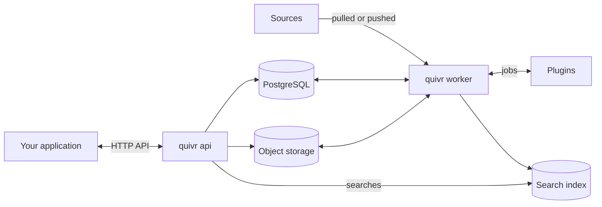
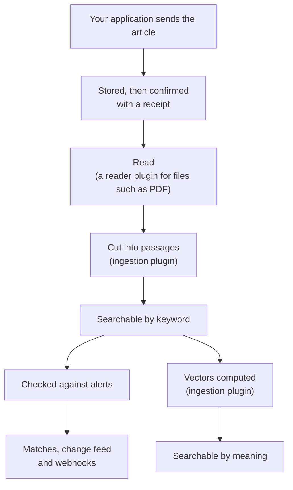

This page explains what happens inside Quivr, for readers who want to trust it before they build on it. You do not need it to follow the [Quickstart](/quickstart).

## The parts

Quivr is one program, `quivr`, that runs as an **API** and a **worker**, next to a few standard services and the plugins you choose:

| Part | What it does |
| --- | --- |
| API (`quivr api`) | Answers your application: accepts documents, runs searches, manages alerts, publishes changes |
| Worker (`quivr worker`) | Does everything that can wait: reads files, prepares text for search, checks alerts, collects sources, sends webhooks |
| PostgreSQL | The record of truth: every document and version, alerts and their matches, and the list of changes |
| Object storage (S3-compatible) | The original bytes of every document and file |
| Search index (Weaviate) | A copy of the text and vectors, organised for fast search. It can always be rebuilt from PostgreSQL and object storage |
| Temporal | Schedules and retries the worker's longer jobs |
| Plugins | Small HTTP services that do the jobs that depend on your content: read a file format, cut text and compute vectors, rank results, judge alerts, collect a source |

The API and the worker scale separately: add API processes for more searches and worker processes for more documents. `quivr migrate` prepares the databases before either starts. [Deploy and configure Quivr](/run-quivr/deploy) gives the details for operators.

## The path of a document

Follow one article from the moment your application sends it:

1. **Stored, then confirmed.** The API writes the article to PostgreSQL and object storage, and only then answers with a receipt. Everything after this happens in the background.
2. **Read.** Plain text needs no reading. A file such as a PDF goes to a reader plugin that extracts its text.
3. **Cut into passages.** The ingestion plugin cuts the text into passages. As soon as they are in the index, the article is searchable by keyword, usually within a second.
4. **Checked against alerts.** Each saved alert's rule decides whether the article matches. A match is recorded with its reason.
5. **Searchable by meaning.** The ingestion plugin computes a vector for each passage, a list of numbers that captures what it means. Once they are in the index, searches by meaning find the article too. Alerts that judge by meaning are asked again at this point.
6. **Told to your application.** Every step that matters is published in the change feed, which your application can follow, and a match can also be sent as a webhook.

When a plugin is down, the work waits and retries; it does not fail. When a plugin refuses a document, for example a damaged PDF, the version is set aside (quarantined) with the reason, and an operator can [process it again](/run-quivr/reprocess-quarantined-versions) once the cause is fixed.

## What Quivr promises

**Nothing confirmed is lost.** Quivr confirms a document only after storing it. A crash, an outage or a slow plugin delays processing; it never drops a document Quivr has confirmed.

**Retrying is always safe.** Every request that creates something carries an idempotency key, a name your application chooses. Sending the same request again with the same key returns the same result instead of a second copy. Reusing a key for a different request is refused with a conflict. After a timeout, your application simply sends the request again.

**History is kept.** A version never changes. A correction creates a new version, and search moves to it only once it is ready, so readers never see a half-processed text. Earlier versions stay readable. A withdrawn document leaves search and alerts for good.

**Search tells the truth.** Every result is checked against stored content and against the caller's access before it is returned, and points to the exact passage it quotes. When a service search depends on is down, search returns an error, never an empty "nothing found".

**The index is disposable.** PostgreSQL and object storage hold the real data. The search index can be rebuilt from them, for example to change the embedding model, while search keeps answering from the old one.

**Notifications arrive at least once.** A webhook is retried until your receiver accepts it or the retry window ends, so it can arrive more than once: your receiver ignores the copies it has seen. Matches stay readable through the API, so a receiver that was down can catch up.

**Your text stays in your installation by default.** The plugins Quivr runs by default, and its embedding model, work inside your installation. Text goes out only through a plugin the operator turns on that calls an outside service, such as a hosted embedding model. [Security](/run-quivr/security) covers the rest.

## Where to go next

<CardGroup cols={2}>
<Card title="Core concepts" icon="book-open" href="/concepts">
Collections, documents, versions, search and alerts, in plain words.
</Card>
<Card title="How plugins work" icon="puzzle" href="/plugins/overview">
The five jobs a plugin can do, and who runs it.
</Card>
</CardGroup>
